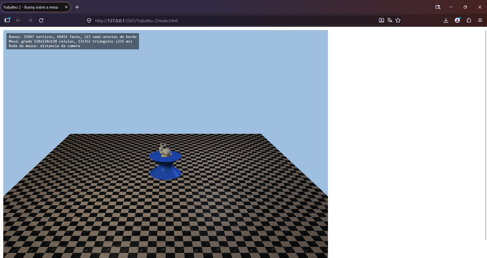
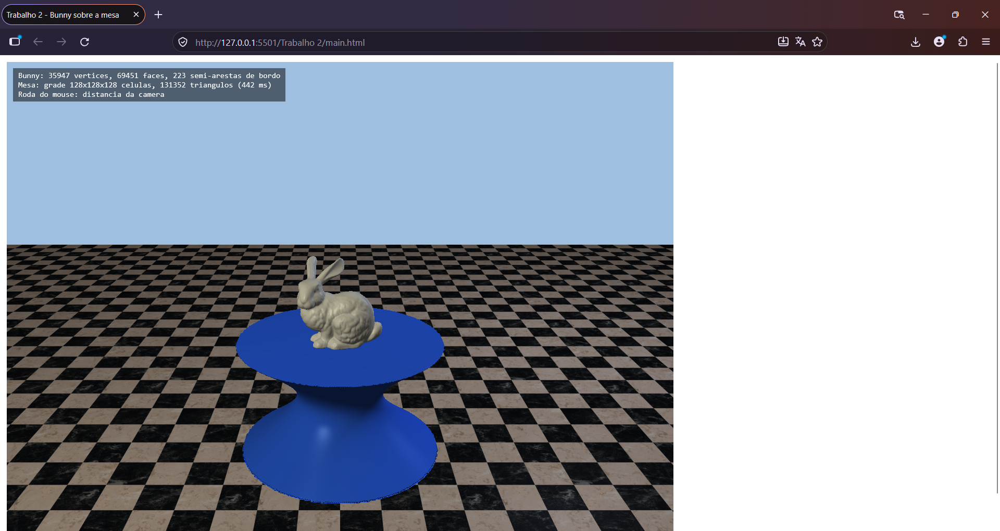

# Trabalho 2: Stanford Bunny sobre uma mesa implícita

**Integrantes:**

- Lucas Silva
- Marcus Bossan
- Thiago Arruda

Cena 3D interativa em WebGPU, sem bibliotecas de renderização. Um modelo Stanford Bunny está apoiado sobre uma mesa gerada a partir de uma superfície implícita, e a mesa está sobre um chão com textura de azulejos.

**Como executar:** abra a pasta `Trabalho 2` no VS Code e inicie `main.html` com o Live Server. É preciso um servidor HTTP porque o projeto usa módulos ES e `fetch`. É necessário um navegador com WebGPU (Chrome ou Edge recentes). A pasta é autônoma e não importa nada dos outros projetos do repositório.

## Resultado

Câmera afastada (visão geral da cena):

Câmera próxima (obtida girando a roda do mouse):

A caixa no canto superior esquerdo é impressa pela própria aplicação e mostra os números usados neste relatório (vértices, faces, bordo, grade e triângulos da mesa).

## Resumo dos números

| Item | Valor |
|---|---|
| Bunny | 35 947 vértices, 69 451 faces |
| Semi-arestas de bordo do Bunny (base aberta) | 223 |
| Grade do marching cubes | **128 × 128 × 128 células** |
| Triângulos da mesa | 131 352 |
| Tempo para gerar a mesa | cerca de 0,2 a 0,4 s (uma vez, na inicialização) |
| Projeção | perspectiva, campo de visão de 45° |

## Organização dos arquivos

| Arquivo | O que faz |
|---|---|
| `main.html`, `main.css`, `main.js` | Página, montagem da cena, câmera, luzes e laço de desenho |
| `half-edge.js` | Estrutura half-edge, percurso das faces de um vértice e normais |
| `load-ply.js` | Leitor de arquivos PLY em ASCII |
| `marching-cubes.js`, `marching-cubes-table.js` | Algoritmo marching cubes e a tabela de 256 casos |
| `implicit-table.js` | Função implícita da mesa, seu gradiente e a geração da malha |
| `scene.vert.js`, `scene.frag.js` | Shaders WGSL (iluminação de Phong por fragmento) |
| `lib/webgpu.js`, `lib/utils.js` | Cópias das bibliotecas do repositório (WebGPU e matrizes) |
| `bunny/`, `texture/` | Dados do modelo e imagens da textura |

## 1. Stanford Bunny e a estrutura half-edge

**Carregamento.** `load-ply.js` lê o arquivo `bun_zipper.ply` e devolve as posições dos vértices e os índices dos triângulos.

**Construção.** `HalfEdgeDS.build` cria vértices, faces e semi-arestas. Cada face tem três semi-arestas ligadas em ciclo. Depois, cada semi-aresta `a→b` é ligada à sua oposta `b→a`, usando uma tabela de busca. As semi-arestas que ficam sem oposta são as de bordo, e o modelo tem 223 delas na abertura da base.

**Uso real da estrutura nas normais.** A função `forEachFaceAround(v)` percorre todas as faces que tocam o vértice `v`:

1. Parte-se de uma semi-aresta que sai de `v`. A face dela é a primeira.
2. A próxima semi-aresta de saída é `he.prev.opposite`, isto é, a oposta da semi-aresta que chega em `v` nessa mesma face.
3. Repete-se até voltar ao início (vértice interno) ou até encontrar uma semi-aresta sem oposta (vértice de bordo).

**Tratamento do bordo.** Cada vértice guarda, de preferência, uma semi-aresta de bordo como ponto de partida. Quando o percurso bate no bordo, ele recomeça no sentido contrário (`he.opposite.next`). Assim, os vértices da borda recebem todas as suas faces, e o laço não fica infinito.

**Normais.** A normal de cada vértice é a soma das normais das faces vizinhas, ponderadas pela área, e depois normalizada. Os 1 113 vértices do arquivo que não pertencem a nenhuma face recebem a normal `(0,1,0)` e nunca são desenhados.

**Posicionamento.** O Bunny é transformado por `T(0, 1.6, 0) · S(s) · T(−cx, −minY, −cz)`:

- primeiro centraliza o modelo em x e z e apoia a base em y = 0;
- depois escala (a altura final é 1,1 unidade);
- por fim sobe até y = 1,6, que é o topo da mesa.

## 2. Mesa implícita (marching cubes)

A mesa é a superfície `F(x,y,z) = 0`, com

`F = max(x² + z² − 0,36 − 2,5·(y − 0,8)², −y, y − 1,6)`

e interior em `F < 0`. Os três termos do `max` dão, respectivamente, a lateral curva, a base plana (y = 0) e o topo plano (y = 1,6).

**Algoritmo** (`marching-cubes.js`, extensão para 3D do marching squares do curso):

1. Avalia `F` uma vez em cada vértice da grade regular do domínio `[-1,6; 1,6] × [-0,2; 1,8] × [-1,6; 1,6]`.
2. Para cada célula, monta um número de 8 bits (um bit por canto, valendo 1 quando `F < 0`). Esse número indica o caso, entre 256 possíveis.
3. A tabela de triângulos (Paul Bourke, domínio público) informa quais arestas da célula são cortadas e como ligá-las.
4. O ponto de corte em cada aresta vem de interpolação linear: `t = Fa / (Fa − Fb)`.

**Resolução escolhida: 128 × 128 × 128 células** (passo de 0,025 em x e z, e 0,0156 em y). Ela deixa a curvatura da lateral bem suave, como se vê na imagem próxima, e gera a malha em menos de meio segundo. A grade em y foi pensada para que os planos y = 0 e y = 1,6 caiam no meio de células, evitando vértices com `F` exatamente zero e triângulos degenerados.

**Normais.** São o gradiente de `F` calculado analiticamente no ramo do `max` que está ativo no ponto: `(2x, −5(y−0,8), 2z)` na lateral, `(0,1,0)` no topo e `(0,−1,0)` na base. O resultado é normalizado. Além disso, a ordem dos vértices de cada triângulo é corrigida para que a face externa coincida com a direção do gradiente.

## 3. Chão e textura

- O chão é um quadrado de lado 24 em y = 0, feito de dois triângulos.
- As coordenadas de textura vão de 0 a 8 em cada eixo, e o sampler usa o modo `repeat`. O padrão aparece, portanto, 8 × 8 vezes.
- A imagem usada é `Tiles074_1K-JPG_Color.jpg`. Foram gerados mipmaps e usada filtragem linear com anisotropia, para evitar cintilação ao longe.
- No fragment shader, a cor amostrada da textura passa a ser a cor difusa (e ambiente) do material do chão.

## 4. Iluminação e materiais

A iluminação de Phong é calculada **por fragmento**, no espaço da câmera, com duas luzes pontuais. Cada fragmento soma:

- a parcela **ambiente**;
- as parcelas **difusa** e **especular** de cada uma das duas luzes.

| Luz | Posição no mundo | Característica |
|---|---|---|
| 1 | (−4, 6, 5) | levemente quente |
| 2 | (5, 4,5, −3) | levemente fria |

As luzes são definidas em coordenadas de mundo e só são levadas ao espaço da câmera dentro do shader, a cada quadro. Por isso permanecem **fixas na cena** quando a câmera se move.

Posições e normais são transformadas para o espaço da câmera com `view · model` e com a matriz normal `transpose(inverse(view · model))`. No fragment shader, a normal interpolada é normalizada de novo. Se o fragmento é visto por trás (por exemplo, o interior do Bunny pela base aberta), a normal é invertida.

| Objeto | Cor (ka = kd) | Especular (ks) | Expoente |
|---|---|---|---|
| Bunny | (0,90; 0,87; 0,80), clara | 0,20 | 30 |
| Mesa | (0,15; 0,35; 0,85), azul | 0,25 | 40 |
| Chão | cor da textura | 0,12 | 24 |

Não há sombras, reflexões nem iluminação global.

## 5. Câmera e interação

- A projeção é perspectiva, com teste de profundidade (`depth24plus`).
- A câmera olha sempre para o ponto `(0; 2,0; 0)`, no centro da mesa e do Bunny, com elevação fixa de 20°.
- A **roda do mouse** muda a distância da câmera ao centro, de 3 a 25 unidades. A mudança é exponencial, então o zoom fica uniforme em qualquer distância.
- Todos os objetos são estáticos. Só a câmera se move.

## 6. O que as imagens mostram

- O fundo é uma cor sólida (azul-claro).
- A mesa tem o topo plano e as laterais curvas, mais estreitas no meio e largas em cima e embaixo. A base toca o chão.
- O Bunny está no centro do topo da mesa, com os pés apoiados.
- O sombreamento do Bunny e da mesa é contínuo, sem facetas. Na mesa aparece um brilho especular discreto na parte inferior.
- A textura aparece repetida muitas vezes e fica nítida de perto (imagem próxima) e sem cintilação de longe (imagem distante).

## 7. Limitações conhecidas

- **Contorno serrilhado.** Não há antialiasing (MSAA), e a silhueta da mesa mostra um leve serrilhado, mais visível no aro da base na imagem próxima.
- **Aro da mesa levemente arredondado.** Como o `max` tem uma quina no encontro entre o topo e a lateral, a interpolação linear a arredonda em cerca de uma célula. O raio máximo gerado é de aproximadamente 1,38, contra 1,40 teórico.
- **Borda do chão visível ao longe.** O chão tem tamanho finito (lado 24). Com a câmera no máximo afastamento, a borda aparece (imagem distante).
- **Vértices fora de faces.** Vértices do PLY que não fazem parte de nenhuma face não são usados na cena.

## 8. Verificação feita

A lógica que não depende de GPU foi executada em Node, fora do navegador:

- a soma das faces visitadas em todas as estrelas é igual a 3 × o número de faces, o que mostra que o percurso cobre todos os vértices, inclusive os de bordo;
- todas as normais do Bunny têm comprimento 1;
- a malha da mesa ocupa `y` de 0 a 1,6, como esperado;
- cerca de 99,5% dos triângulos da mesa ficaram com a face externa coerente com o gradiente (os demais são triângulos finos perto do aro, onde as normais mudam rápido).

O desenho foi conferido no navegador pelas duas capturas acima.
